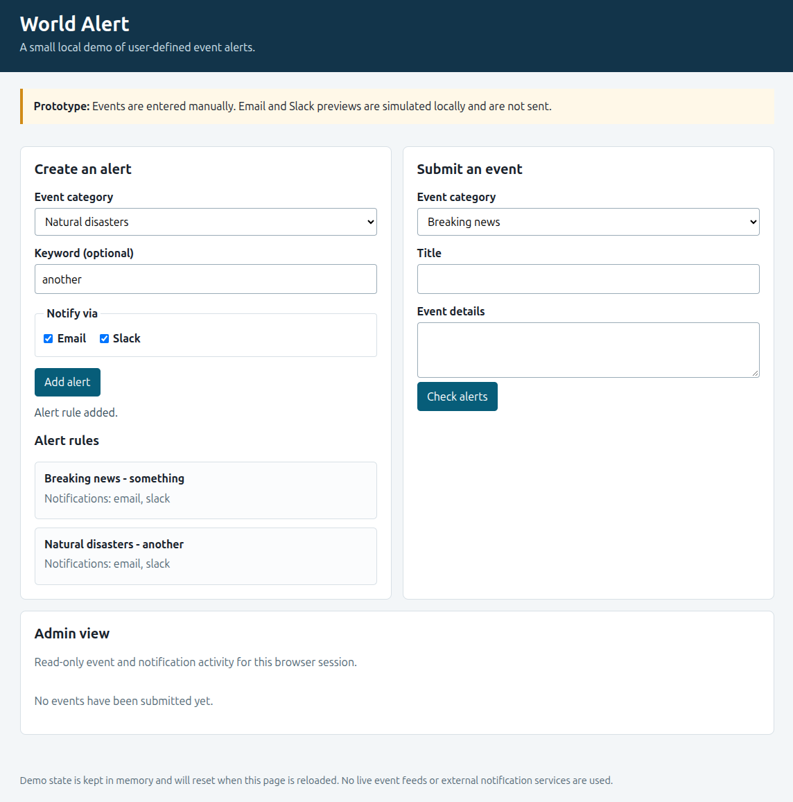
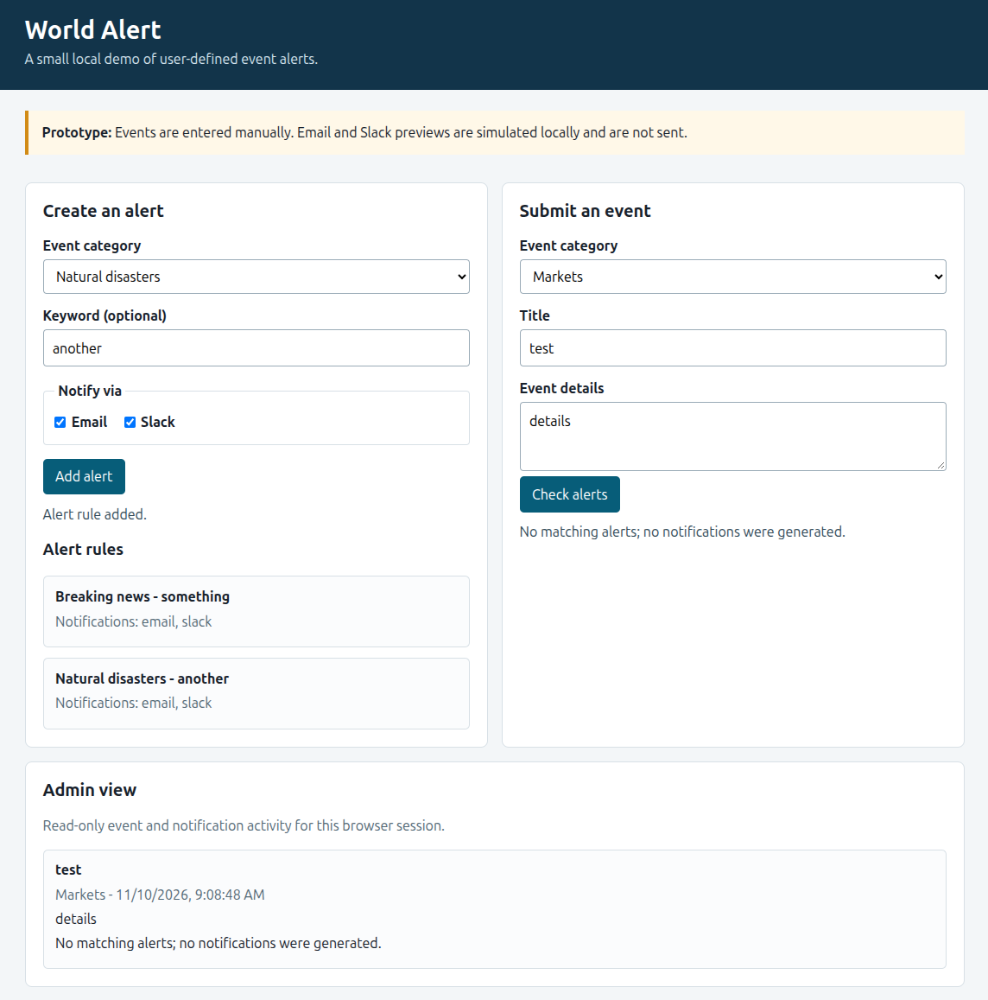
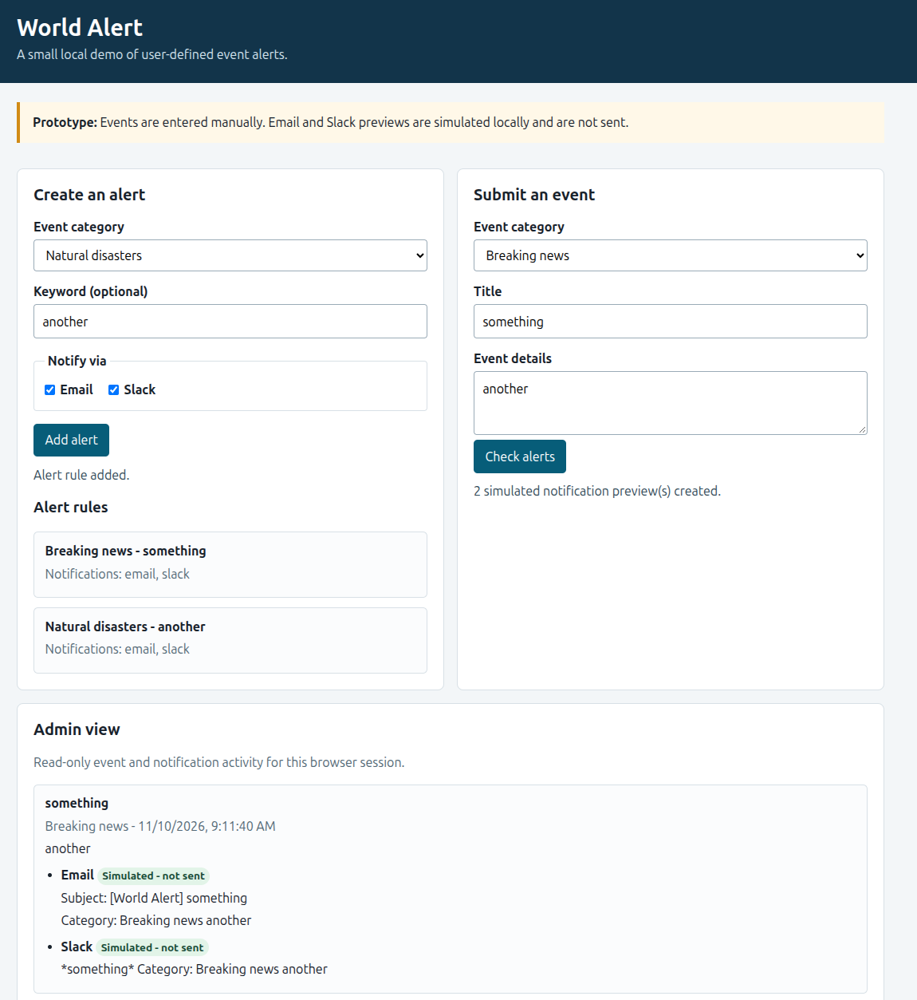

# World Alert

A local, single-user prototype for creating event alert rules, matching manually entered events, and inspecting simulated Email and Slack notification previews.

The demo does not ingest live world events or send messages to external services. Its state is kept in memory and resets when the page is reloaded.

## Assignment

This project implements a world-event alerting system based on an intentionally vague product brief. \
The original assignment is available [here](docs/assignment/task-04-feature-design-and-build.docx). \
The goal is not only to deliver a working implementation, but also to demonstrate the AI-assisted development process, including planning, architectural decisions, prompt history, critical evaluation, and validation.

## AI Tools Used
- **IntelliJ IDEA with GitHub Copilot (GPT-6 Luna)** - Requirements analysis, MVP planning, code generation, and implementation.
- **ChatGPT (OpenAI, GPT-6)** - Independent review of the implementation plan, assumptions, architecture, source code, tests, and documentation; guidance on scope reduction and improvements.

## Run locally

Requires Python 3 to serve the static files; no packages or network access are needed.

```sh
cd frontend
python3 -m http.server 8080
```

Open <http://localhost:8080/> in a browser.

## Run tests

With the local server running, open <http://localhost:8080/tests.html>. The page runs browser checks for matching, channel previews, and the rule-to-admin UI flow; it reports the pass count and sets `data-result="passed"` when all checks pass.

## Demo Screenshots

The following screenshots demonstrate the core MVP workflow. Events are entered manually, and email and Slack notifications are simulated locally rather than delivered.

### 1. Creating Alert Rules
Users can configure alert rules by selecting an event category, specifying an optional keyword, and choosing email and/or Slack notification channels.



### 2. Non-Matching Event
An event that does not match any configured alert rule is recorded in the admin view without generating notification previews.



### 3. Matching Event
When an event matches a configured alert rule, the application generates simulated notification previews for the selected channels. The admin view shows both previews, explicitly marked as not sent.



## Process documentation

- [Requirements and assumptions](docs/01-assumptions.md)
- [Implementation plan](docs/02-implementation-plan.md)
- [Architecture](docs/03-architecture-plan.md)
- [Decision log](docs/04-decision-log.md)
- [AI prompt history](docs/05-ai-prompt-history.md)
- [Validation log](docs/06-validation-log.md)
- [Retrospective](docs/07-retrospective.md)
